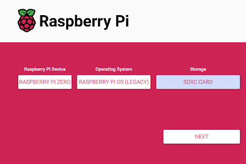
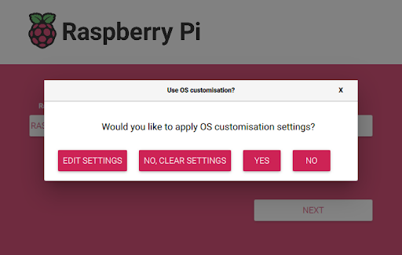
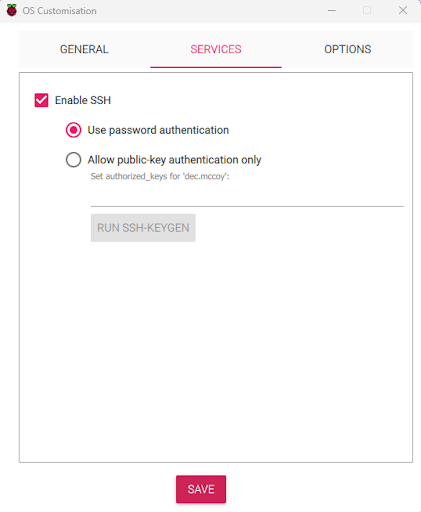
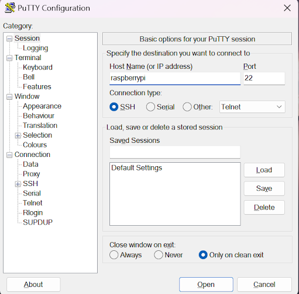

<a id="readme-top"></a>

# Raspberry Pi Epaper Photo Frame

This project displays photos on an Epaper photo frame using a connected Raspberry Pi Zero.
This repo holds both the onboard software for the Pi and the script to convert photos on a
computer and send them to the Pi over the network.

Photos are converted on your computer and only finished bitmaps are sent to the Pi. Decoding
HEIC and dithering to the panel's seven colours takes seconds on a laptop and a very long time
on an ARMv6 Zero W, so the Pi does none of it.

## Getting Started

### Cloning

```bash
git clone https://github.com/decmccoy/epaper-rolling-photo-display.git
```

### File Structure

Onboard Pi files:

```text
├── pi/
│   ├── main_loop.py        # the display loop, started by systemd
│   ├── display.py          # Waveshare panel wrapper
│   └── config.py           # settings, all overridable by environment variable
├── deploy/
│   ├── install.sh          # one-time setup on a fresh image
│   ├── epaper.service      # runs the display loop
│   ├── epaper-update.*     # timer that pulls updates from GitHub
│   └── post-receive        # git push straight to the Pi, for bench work
└── requirements-pi.txt
```

Image transfer script files:

```text
├── sender/
│   ├── load_photos.py      # CLI entry point
│   ├── conversion.py       # HEIC/JPG/PNG -> 7-colour bitmap
│   └── transfer.py         # SFTP mirror to the Pi
├── EXAMPLE_raspberry_pi_info.json
└── requirements-sender.txt
```

### Setting up the Raspberry Pi

#### Dependancies

- [Raspberry Pi Imager](https://www.raspberrypi.com/software/)
- An SSH client ([PuTTY](https://www.chiark.greenend.org.uk/~sgtatham/putty/latest.html) on
  Windows, or the built-in `ssh` command)
- [Bonjour Print Services](https://support.apple.com/kb/DL999), if you are on Windows and want
  to reach the Pi by its `.local` name

#### Imaging the micro SD card

Plug the card into a computer, open the imager and select **Raspberry Pi OS Lite (32-bit)**,
under `Raspberry Pi OS (other)`:<br/>
<br/>

> ⚠️ 32-bit is not a preference. The Pi Zero W is ARMv6 and the 64-bit images will not boot.
> Lite rather than Desktop, because there is no monitor and only 512&nbsp;MB of RAM.

Click `NEXT`, then `EDIT SETTINGS`:<br/>
<br/>

- Set the hostname, and your own username and password
    > ⚠️ Don't forget these values
- Select `Configure wireless LAN` to enter your wifi credentials, and set the wifi country
- Set your locale and timezone

Select Enable SSH:<br/>
<br/>

Public-key authentication is recommended over a password. Generate a key first if you do not
already have one, then paste the public half into the imager:

```bash
ssh-keygen -t ed25519 -C "epaper-frame"
```

Then press `SAVE` and write the image to the card.

#### Enabling USB gadget mode

Before ejecting the card, while the `bootfs` partition is still visible, enable USB gadget
mode. This gives you a shell over a plain USB cable even when the wifi settings are wrong,
which saves re-imaging the card.

- In `config.txt`, under `[all]`, add `dtoverlay=dwc2`
- In `cmdline.txt` — **one single line, never add a newline** — insert
  `modules-load=dwc2,g_ether` immediately after `rootwait`

#### First boot

Insert the micro SD into the Pi and plug it in. The first boot takes ten minutes or more while
it resizes the filesystem, so be patient. It is not hung.

### Connecting to the Pi

There are two ways in. The USB cable always works; wifi is more convenient once the Pi is on
the network.

#### Over a USB cable

Connect a cable from your computer to the Pi's `USB` port — **not** `PWR IN`, which only
supplies power. With gadget mode enabled the Pi appears as a network device:

```bash
ssh <username>@<hostname>.local
```

On Windows, `.local` names over this link are resolved by Bonjour, so install it if the
hostname is not found.

#### Over wifi

Once the Pi has joined your network you can reach it over wifi with the same command:

```bash
ssh <username>@<hostname>.local
```

Or, using PuTTY, enter the host name of the Pi and click `Open`:<br/>
<br/>

To add another wifi network — for example the one the frame will live on — connect over the
cable or the current network and run:

```bash
sudo nmcli connection add type wifi con-name <name> ifname wlan0 \
  ssid "<SSID>" wifi-sec.key-mgmt wpa-psk wifi-sec.psk "<PASSWORD>"
sudo nmcli connection modify <name> connection.autoconnect yes \
  connection.autoconnect-priority 10
nmcli connection show
```

> The Zero W radio is 2.4&nbsp;GHz only, so the network has to broadcast a 2.4&nbsp;GHz band.

### Installing the onboard software

Once connected to the Pi:

```bash
git clone https://github.com/decmccoy/epaper-rolling-photo-display.git ~/epaper
~/epaper/deploy/install.sh
```

`install.sh` enables SPI, installs the apt packages, creates the virtualenv, fetches the
Waveshare driver, and enables both systemd units. It is safe to re-run.

Check it came up, and smoke-test the panel:

```bash
systemctl status epaper
journalctl -u epaper -f

~/epaper/.venv/bin/python -c "from waveshare_epd import epd5in65f; \
  e = epd5in65f.EPD(); e.init(); e.Clear(); e.sleep(); print('panel OK')"
```

### Executing the script

Install the desktop dependencies and create your config:

```bash
pip install -r requirements-sender.txt
cp EXAMPLE_raspberry_pi_info.json raspberry_pi_info.json
```

- Download all the photos as a zip file
- Fill in `raspberry_pi_info.json` with the Pi's hostname, username, and the path to your SSH
  key. It is gitignored, so it never leaves your machine
- Run the following command in the base directory:

```bash
python -m sender.load_photos --zip "path/to/album.zip"
```

| Flag | Effect |
| --- | --- |
| `--zip` | The exported album zip. Required. |
| `--album` | Subfolder inside the zip. Omit to use everything. |
| `--no-send` | Convert only. Use this to eyeball the bitmaps first. |
| `--keep-working` | Leave the intermediate JPEGs in place for inspection. |
| `--config` | Point at a different settings file. |
| `--verbose` | Log every file, not just a summary per photo. |

Only changed photos are uploaded, and photos removed from the album are deleted from the Pi,
so re-running after adding one photo transfers one photo.

## Deploying code changes

The Pi checks GitHub every 15 minutes and restarts itself if anything changed, so it can pick
up changes without needing any inbound access to it.

```bash
git push origin main     # the frame picks it up within 15 minutes
```

To force an immediate update, or to check on it:

```bash
sudo systemctl start epaper-update.service
journalctl -u epaper-update -n 20
```

While the Pi is on your bench you can also push straight to it. Copy `deploy/post-receive`
into a bare repo on the Pi and add it as a remote:

```bash
# on the Pi
git init --bare ~/epaper.git
cp ~/epaper/deploy/post-receive ~/epaper.git/hooks/ && chmod +x ~/epaper.git/hooks/post-receive

# on your computer
git remote add pi ssh://<username>@<hostname>.local/home/<username>/epaper.git
git push pi main
```

## Development

The display loop runs on a normal computer without a panel attached:

```bash
EPAPER_DRY_RUN=1 EPAPER_DISPLAY_SECONDS=2 python -m pi.main_loop
```

Every setting in `pi/config.py` has an environment variable override, listed in that file.
Photos and display state live in `~/epaper-data`, deliberately outside the git working tree
so that a deploy's `git reset --hard` can never delete them.

## Authors

- [decmccoy](https://github.com/decmccoy)
- [darcymccoy](https://github.com/darcymccoy)

<p align="right">(<a href="#readme-top">back to top</a>)</p>
